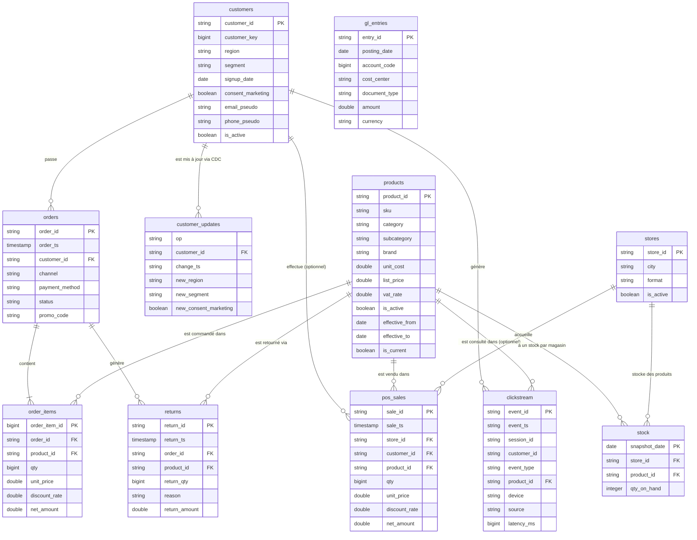

# Modèle de données — NeoRetail

Diagramme entité-relation des sources brutes (Bronze layer).
Rendu automatiquement par GitHub, VS Code (extension Markdown Preview Mermaid) et Notion.

## Notes

- **SCD2** : `products` a des colonnes `effective_from` / `effective_to` / `is_current` pour gérer l'historique des changements de prix. Le fichier `customer_updates` est la source CDC pour appliquer SCD2 sur `customers` en Silver.
- **Achat anonyme** : `pos_sales.customer_id` est nullable — 27.93% des ventes en magasin sont anonymes (sans carte de fidélité).
- **Clickstream partiel** : `clickstream.product_id` est nullable — les événements `page_view` et `search` ne sont pas liés à un produit précis.
- **stock** : table synthétique générée par `generate_stock.py`, absente du pack prof.
